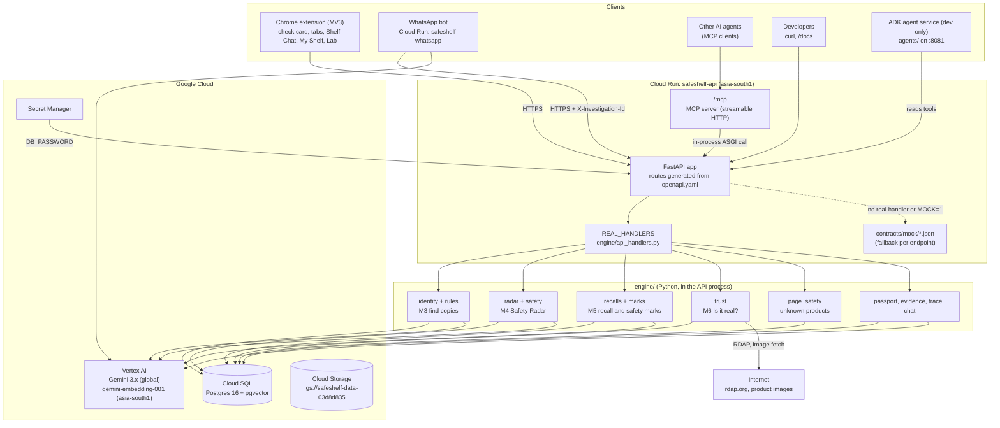
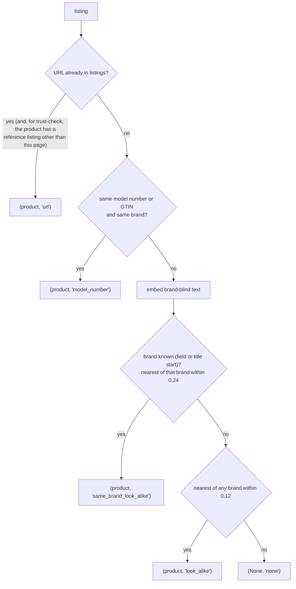
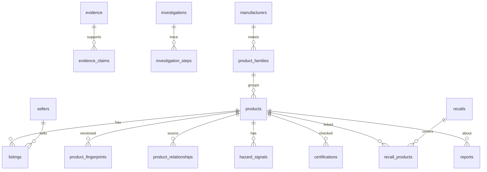

# SafeShelf Global: complete project brief

Team **Hashes** (Seshu Madhavan, team leader; Solomon Wilson R) · AI Builder Cup 2026 (Google Cloud JAPAC) · Theme **Retail & Commerce**
Status as of **15 Oct 2026 (Day 4 of 6)** · Submission deadline **18 Oct 2026, 11:59 PM IST** (target: 17 Oct) · Feature freeze: evening of 16 Oct

This file is the single brief: what SafeShelf is, how it is built (high and low level), what works today, what does not, and what is left to do. The longer source documents are linked where they hold more detail.

| Doc | What it holds |
|---|---|
| [SAFESHELF.md](SAFESHELF.md) | Full product vision and design (v1.1): 19 modules, data model, API, agents, evaluation |
| [MODULES.md](MODULES.md) | The 19 build modules (M0–M17), steps, dependencies, "done when" |
| [PARALLEL_PLAN.md](PARALLEL_PLAN.md) | Day-by-day split for Person A (Brain) and Person B (Face) |
| [PROGRESS.md](PROGRESS.md) | Build log up to 13 Oct: cloud, engine, data, backtest |
| [HANDOFF_PERSON_A.md](HANDOFF_PERSON_A.md) | What the extension needed from the API on 14 Oct |
| [BACKTEST.md](BACKTEST.md), [bench/README.md](bench/README.md) | Backtest method and results |
| [HACKATHON.md](HACKATHON.md) | Rules, judging, submission, deck template |
| [TOOLS.md](TOOLS.md) | Google tools, data sources, open-source tools, Firecrawl budget |
| [contracts/openapi.yaml](contracts/openapi.yaml) | The API contract every component builds against |
| [IMPACT.md](IMPACT.md) | Social impact and awareness plan: "still on sale" report, child safety, Hindi recall alerts, partners (after core setup) |

---

## 1. TL;DR

SafeShelf checks any product listing and answers two questions:

1. **Is it safe?** Official recalls, hazards spotted in buyer reviews and review photos (often before a recall), and safety-mark checks against official registries.
2. **Is it real?** Photos copied from the genuine product, a price far below anything the genuine product sells for, a brand-new website, specs that contradict the genuine model, and text hidden on the page to manipulate AI assistants.

Both answers sit on one **product identity engine** that recognises the same product under different listings and brand names, with a strict rule: **only an exact model inherits a recall; a possible rebrand goes to a human; a look-alike never does.**

What exists today:
- A **live API on Cloud Run** (FastAPI, contract-driven) backed by a **real engine on Cloud SQL (Postgres + pgvector)** and **Gemini 3.x on Vertex AI**. 15 of 17 endpoints answer with real data; the other 2 return contract examples.
- A real catalog: **27,492 Amazon + 286 Amazon.in/Flipkart products, 29,379 real reviews**, **2,537 CPSC recalls**, **8,470 Australian energy-registry records**.
- A **backtest** on 25 past CPSC recalls and 40 never-recalled controls: SafeShelf flagged **6/25 recalls early with 2/40 false alarms (5%)**, against Gemini alone at 6/25 with 6/40 (15%) and keyword rules at 11/25 with 11/40 (28%). Twin pooling is what makes it work (1/25 without it).
- An **MCP server** at `/mcp` so other AI agents can use the same tools.
- A **Chrome extension** (MV3) with an in-page check card, tabs per API, Shelf Chat with evidence quotes, My Shelf (local), a report form and a Judges' Lab page.
- A **WhatsApp bot** (link or photo in, English or Hindi text plus voice note out), built and tested, not yet connected to a WhatsApp number.

Biggest open items: a judge-accessible web entry point (the Lab is currently an extension page), the demo video and deck, Catalog Scan and My Shelf backends, and `trust-check` latency on cold paths.

---

## 2. The hackathon

| Item | Detail |
|---|---|
| Event | AI Builder Cup 2026, Google Cloud JAPAC, run by Hack2skill |
| Theme | Retail & Commerce: "Intelligent Customer and Business Experiences" |
| Required stack | Gemini or Gemma; an agentic platform (Agent Platform, Antigravity or AI Studio); deployed on Google Cloud (Cloud Run or Firebase) |
| Submission | Working deployed link, public GitHub repo, 3-minute demo video, deck (PDF from the official 16-slide template), all in English |
| Judging | Technical merit & GenAI 40% · Problem alignment & impact 25% · Innovation 25% · UX 10% |
| Prizes | $10k / $7k / $5k, plus $2k each for Best use of Google Cloud AI, Most Impactful, Social Choice, Best UI/UX |
| Timeline | Submit by 18 Oct · Top 50 shortlist 7 Nov · Finale 4 Dec, Singapore |
| Model warning | Gemini 2.5 Pro/Flash/Flash-Lite retire on Vertex on **16 Oct 2026**. Build on 3.x only |

**What wins** (from SAFESHELF.md §20 and HACKATHON.md): one named user and one painful workflow, a measured before/after, a human-in-the-loop safeguard, deep use of Google tech, a product that works end to end, one memorable moment. Overbuilding loses.

---

## 3. Problem and users

**The problem**
- An OECD sweep found **87%** of banned or recalled products still on sale online.
- India's BIS seized **3,500+** uncertified or fake-ISI items from Amazon and Flipkart warehouses; Australia's ACCC pledge signatories removed ~31,000 unsafe listings in 2024–25.
- Buyers post complaints and photos of melted ports and swollen batteries **weeks or months before** a recall. Nobody connects them in time.
- One white-label product is sold under dozens of brand names. A recall of one name leaves the identical twins on sale.
- Certification claims (BIS R-numbers, energy stars) can't be checked by shoppers. Fake shops copy genuine photos and sell at impossible prices.

**Users**

| User | Pain | What SafeShelf gives them |
|---|---|---|
| Marketplace safety analyst (first paying user) | Reads complaints by hand, finds relistings by accident | Ranked hazard findings, linked product families, evidence packs |
| Shopper | Can't tell if a product is genuine, certified or dangerous | Extension card, chat, WhatsApp answer, in Hindi and aloud |
| Retailer / brand | Duplicate records, counterfeits using the brand | Catalog Scan, copy detection |
| Regulator / researcher | Manual, point-in-time sweeps | Traceable evidence, investigation trace |
| Developers and AI shopping agents | No trustworthy product-safety API | REST + MCP tools with evidence IDs |

**Out of scope on purpose:** payment, UPI, phishing-SMS and call scams. "Is it real?" covers only deception about the *product*, checked against the genuine product's identity.

---

## 4. Principles that shape every line of code

1. **Code decides, the model reads.** Gemini extracts, labels and compares. Deterministic code sets every verdict colour, relationship class and flag. Page text can't change a verdict.
2. **Evidence, not verdicts.** Wording is "Be careful: …", "under review", "AI finding – not a regulatory determination". Never "scam", never "dangerous" without an official recall.
3. **Recall inheritance is strict.** Only `exact_model` (verified) inherits a recall. `rebranded_equivalent` needs a human. `visually_similar` never inherits.
4. **Abstain honestly.** `not_enough_evidence` and `unknown` exist and are never shown as good news. Fewer than 20 reviews read is not "safe".
5. **Nothing is deleted.** Evidence rows are immutable and hashed (duplicates count once). Fingerprints and relationships are versioned; changes go to `audit_events`.
6. **Untrusted input is data.** Every prompt says so; reviews, notices and page text are wrapped in tags; hidden-instruction text is detected and reported as a warning sign.
7. **Privacy.** Reviewer IDs and reporter refs are SHA-256 hashed. Report text has emails, phones and self-introduced names masked. The extension strips address, pincode, email and phone lines before sending.
8. **One front door.** Every client (extension, chat, WhatsApp, MCP, Lab) calls the same API. No client has its own AI logic.
9. **Contract first, mocks always work.** `contracts/openapi.yaml` + `contracts/mock/*.json` let the two tracks build in parallel. `MOCK=1` must always run.
10. **Cheap first, expensive last.** Exact identifiers → vector search → Gemini only for unclear cases. Every Gemini result is cached in the `evidence` table so it is paid for once.

---

## 5. High-level architecture

### 5.1 System view



### 5.2 Layers

| Layer | Responsibility | Where |
|---|---|---|
| Clients | Read the page or message, show results, never decide verdicts | `extension/`, `whatsapp/`, `agents/` |
| API | Contract, routing, real-or-mock, key check, size limit, logging, MCP, tracing | `api/app/` |
| Engine | Identity, safety, recalls, marks, trust, passport, chat | `engine/` |
| Data | Loaders, collectors, schema, demo seed | `data/` |
| Evaluation | Backtest and SafeShelfBench | `bench/` |
| Contract | OpenAPI, mocks, demo IDs | `contracts/` |

### 5.3 Vision vs what is built

The full vision (SAFESHELF.md §4, §13.1, §14) includes Agent Engine, a Concierge with parallel sub-agents, computer-use Shopper and Research agents, Pub/Sub workers, BigQuery, Firebase Auth and Messaging, and A2A. For the hackathon, the team built **one deep slice**: the engine runs inside the API process, Shelf Chat is a single grounded Gemini call inside the API, and agents reach SafeShelf over MCP. The items not built are listed in §15.

---

## 6. Repository map

```
all-builders/
├── api/                    M7 API server (Cloud Run)
│   ├── app/main.py         routes from the contract, real-or-mock, guard + JSON logs, /health
│   ├── app/mcp_server.py   /mcp: 8 read-only MCP tools over the same routes
│   ├── Dockerfile          built from a staging folder (.build/) by `make deploy-api`
│   └── tests/test_contract.py
├── engine/                 Person A: the brain (runs inside the API)
│   ├── api_handlers.py     operationId -> handler map, `traced` wrapper
│   ├── gemini.py           Vertex client, structured JSON calls, model fallback, hard timeouts, usage tracking
│   ├── store.py            Postgres/pgvector access, evidence, versioned fingerprints and relationships
│   ├── normalize.py        brand/model/unit normalisation, model-number extraction, brand-blind text
│   ├── identity.py         M3: resolve, identify, duplicates, relationships
│   ├── rules.py            M3: code decides the 5 relationship classes; recall inheritance
│   ├── radar.py            M4: review + photo labelling (Gemini), findings + verdict (code)
│   ├── safety.py           M4: GET safety: stored reviews, cached labels, photo checks, official status
│   ├── recalls.py          M5: link recalls to products (exact model vs needs review), twin inheritance
│   ├── marks.py            M5: safety-mark claims, Australian registry + BIS mock checks
│   ├── trust.py            M6: "Is it real?" checks and summary
│   ├── page_safety.py      "Is it safe?" for a listing with no stored product
│   ├── passport.py         product, history, alternatives, reports (PII masking), bench results
│   ├── evidence.py         GET /v1/evidence: plain-words source + exact quote per evidence ID
│   ├── trace.py            investigation steps: tool, models, seconds, tokens, cost
│   ├── chat.py, chat_core.py  Shelf Chat handler and its rules/prompt
│   └── tests/              11 test files (radar cases, rules, trust, M5, page safety, ...)
├── contracts/              shared: openapi.yaml, mock/*.json (17), demo_products.json
├── data/                   M1 loaders and collectors, schema.sql, demo seed, demo JSON registries
├── bench/                  M2 backtest.py, results.json, README table
├── extension/              Person B: Chrome MV3 extension, demo shop pages, Node tests
├── agents/                 Person B: ADK Shelf Chat service (local dev) + the original chat handler
├── whatsapp/               M12 bot: bot.py (words, pure), app.py (webhook, Gemini vision + TTS), Dockerfile
├── feasibility/            first feasibility test scripts (CPSC vs Amazon reviews)
├── web/, lab/              placeholders (web/ holds only a Firebase .env.example)
├── docker-compose.yml      local Postgres + pgvector on :5442
├── Makefile                dev, test, deploy, bench, warm commands
└── *.md                    design, plan, progress, rules, competitors
```

**Branches:** `main`, `dev` (integration), `person-1` (Person A, current), `person-2` (Person B). Work for both tracks has been merged into `person-1`/`dev` (commit `af2c40f`). The previous ClearSight research is kept on `archive/pre-safeshelf`.

---

## 7. Infrastructure and deployment

| Resource | Value |
|---|---|
| GCP project | `project-03d8d835-d5c5-4ad4-bf8` |
| Region | `asia-south1` (Mumbai) for Cloud Run, Cloud SQL, embeddings |
| API service | Cloud Run `safeshelf-api`: https://safeshelf-api-368488022657.asia-south1.run.app (`/docs`, `/health`, `/mcp`) |
| API settings | `--min-instances 1 --memory 1Gi --timeout 300`, unauthenticated, Cloud SQL socket attached, `MOCK=0` |
| Database | Cloud SQL `safeshelf-db`, Postgres 16 + pgvector, smallest tier. Password only in Secret Manager (`safeshelf-db-password`) |
| Bucket | `gs://safeshelf-data-03d8d835`: raw data, review files, catalog files, job scripts |
| WhatsApp service | Cloud Run `safeshelf-whatsapp` via `make deploy-whatsapp` (needs secrets `wa-token`, `wa-phone-id`, `wa-app-secret`, `wa-verify-token`); **not deployed yet** |
| Firebase | Project `shelf2026-3656b` (Google sign-in, Firestore in Mumbai); **not wired into any app** |
| Batch compute | Throwaway Compute Engine VMs with startup scripts (`data/vm_*.sh`) that stream Amazon Reviews 2023, upload to the bucket and shut down |

**Gemini on Vertex** (checked 12–13 Oct): 3.x models answer only on location `global`.

| Use | Models (tried in order) | Config |
|---|---|---|
| Pair compare, notices, mark claims | `gemini-3.5-flash` → `gemini-3-flash-preview` → `gemini-3.5-flash-lite` | `SAFESHELF_COMPARE_MODELS`, 30 s per model, temperature 0, JSON schema, thinking level low |
| Review labelling (live) | same order, 60 s per batch of 15 | `radar.classify` |
| Review labelling (bulk/backtest), photo checks | `gemini-3-flash-preview` first | faster under load, 20/20 on hand labels |
| Shelf Chat | `gemini-3.5-flash` → `gemini-3-flash-preview` → `gemini-3.5-flash-lite` | `SAFESHELF_CHAT_MODELS`, 20 s per model, temperature 0.2 |
| Embeddings | `gemini-embedding-001`, 768 dims, `SEMANTIC_SIMILARITY`, unit-normalised | `asia-south1`, ~0.3 s warm |
| WhatsApp TTS | `gemini-2.5-flash-tts` → ffmpeg → OGG/Opus | `SAFESHELF_TTS_MODEL` |
| Computer use (not used) | `gemini-3.8-flash` works but took up to 244 s per call | |

**Deploy** (`make deploy-api`): copies `api/`, `engine/`, `contracts/`, the three demo JSON files from `data/` and `bench/results.json` into `.build/`, then `gcloud run deploy --source .build`. `DEPLOY_MOCK=1` deploys an examples-only API.

**Warm-up** (`make warm`): runs the demo trust-checks and the safety/certifications reads for `SS-P-10291`, `SS-P-30118`, `SS-P-50001`, `SS-P-60002` so the first click in a demo answers in seconds.

---

## 8. Low-level design: the API (`api/app/`)

### 8.1 Request lifecycle

```mermaid
sequenceDiagram
  participant C as Client
  participant G as guard_and_log middleware
  participant R as route (make_route)
  participant T as traced wrapper
  participant E as engine handler
  participant DB as Cloud SQL
  C->>G: HTTP request
  G->>G: 413 if body > 1 MB; 401 on /mcp without key (when API_KEY set)
  G->>R: call_next
  R->>R: check_key (if API_KEY set)
  alt MOCK=0 and REAL_HANDLERS has operationId
    R->>T: real handler
    T->>T: X-Investigation-Id? start gemini.track()
    T->>E: run_in_threadpool(engine fn)
    E->>DB: reads / writes
    T->>DB: trace.record(step: tool, models, seconds, tokens, cost, summary)
    R-->>C: 200 JSON, X-SafeShelf-Source: real
  else no real handler
    R-->>C: contract example, X-SafeShelf-Source: mock
  end
  G->>G: one JSON log line (method, path, status, ms, source, investigation_id)
```

Key details:
- Routes are **generated from `openapi.yaml`**: each operation's `operationId` and `x-mock` file. Adding an endpoint to the contract makes it exist immediately (as a mock).
- `REAL_HANDLERS` loads `engine.api_handlers.HANDLERS` only when `MOCK=0` and a database is configured (`DATABASE_URL` or `CLOUD_SQL_INSTANCE`).
- `/docs` shows the contract itself, with each endpoint's mock as its example.
- `/health` returns `{ok, mock, real_endpoints[]}`. The extension and Lab use it to decide what to show.
- `/health` is not `/healthz` because Cloud Run reserves paths ending in "z".
- CORS is open (`*`). The API key (`X-API-Key`) is checked only when `API_KEY` is set; it is **not set on the live service** today.
- MCP is mounted last at `/` so only `/mcp` reaches it; its lifespan is merged into the app's.

### 8.2 Endpoints

| Method + path | operationId | Engine function | Live | Gemini on a cold call? |
|---|---|---|---|---|
| POST `/v1/products/identify` | identifyProduct | `identity.identify` | real | embedding only |
| POST `/v1/products/duplicates` | findDuplicates | `identity.duplicates` (`refresh` optional) | real | yes: one compare per candidate pair (6 in parallel) |
| GET `/v1/products/{id}` | getProduct | `passport.product` | real | no |
| GET `/v1/products/{id}/safety` | getSafety | `safety.safety` | real | yes for unlabelled reviews and up to 5 photos; cached after |
| GET `/v1/products/{id}/relationships` | getRelationships | `identity.relationships` | real | no |
| GET `/v1/products/{id}/history` | getHistory | `passport.history` | real | no |
| GET `/v1/products/{id}/certifications` | getCertifications | `marks.certifications` | real | only when regex finds no mark (cached) |
| GET `/v1/products/{id}/alternatives` | getAlternatives | `passport.alternatives` | real | no |
| POST `/v1/listings/trust-check` | trustCheck | `trust.trust_check` | real | embedding (via `identity.resolve`) |
| POST `/v1/listings/safety-check` | listingSafetyCheck | `page_safety.listing_safety` | real | review labels for page reviews; recall notice reads (cached) |
| POST `/v1/reports` | createReport | `passport.create_report` | real | no |
| GET `/v1/evidence?ids=` | getEvidence | `evidence.lookup` (max 50 IDs) | real | no |
| GET `/v1/bench/results` | getBenchResults | `passport.bench_results` | real | no |
| GET `/v1/investigations/{id}/trace` | getTrace | `trace.get_trace` | real | no |
| POST `/v1/agent/sessions` | startAgentSession | `chat.start_agent_session` (`mode=chat` only; `investigate` → 501) | real | yes, one call per question |
| POST `/v1/shelf/items` | addShelfItem | none | **mock** | |
| POST `/v1/catalog/scan` | catalogScan | none | **mock** | |

Unknown product IDs return 404 (`KeyError` → `HTTPException`). Missing listing fields return 422. Every real handler except `getTrace` is wrapped by `traced`.

### 8.3 MCP server (`api/app/mcp_server.py`)

- Streamable HTTP, **stateless**, JSON responses, so any Cloud Run instance can serve any request. DNS-rebinding protection is off (public HTTPS host).
- Each tool calls the REST route **in-process** through `httpx.ASGITransport`, so agents get exactly what screens get: same real-or-mock answer, same key check, same trace.
- Tools (all `read_only_hint`): `identify_product`, `product_safety`, `check_listing`, `find_copies`, `safety_marks`, `safer_alternatives`, `product_history`, `investigation_trace`. Each accepts an optional `investigation_id`.
- Server instructions tell the calling agent the verdict colours, that AI findings are not regulatory determinations, and never to call a seller a scam.

---

## 9. Low-level design: the engine (`engine/`)

### 9.1 `gemini.py`: every model call

- One shared `genai.Client` per location, built under a lock (a racing second client was garbage-collected mid-request on 13 Oct).
- SDK timeout 30 s with retries off; **plus** a hard wall-clock limit through a 32-worker thread pool (`_bounded`), because the SDK timeout once failed to fire and a call hung for 21 minutes. An overrun call is abandoned.
- `structured(prompt, schema, models, timeout_s)`: JSON-schema output at temperature 0; on timeout, 429, 5xx or bad JSON it moves to the next model; the answer records which model produced it. Accepts multimodal parts (image + text).
- `embed(texts)`: batches of 50, 768 dims, unit-normalised.
- `track()` / `_record()`: a `ContextVar` collects model, input and output tokens (including thinking tokens) per request for the trace.
- `COMPARE_PROMPT` + `COMPARE_SCHEMA`: agreements, conflicts, proposed class, confidence, needs_human, `would_change_if` (counterfactuals), evidence spans.

### 9.2 `store.py`: persistence

- One shared psycopg 3 connection (autocommit, dict rows), reopened if broken. On Cloud Run it connects over the Cloud SQL unix socket with `DB_PASSWORD` from Secret Manager, so the password never appears in a URL.
- IDs: `short_id(prefix, *parts)` = prefix + first 8 hex of SHA-1. Products `SS-P-…`, listings `SS-L-…`, evidence `EV-…`, hazard signals `HZ-…`, reports `SS-R-…`. Catalog products use `SS-P-AMZ-<ASIN>` style IDs.
- `add_evidence(source_type, source_ref, content)`: content is canonical JSON; its SHA-1 is the dedupe key, so identical evidence is stored once and returns the existing ID.
- `save_fingerprint`: a new version only when the fingerprint changed.
- `save_relationship`: a new version only when class, status or evidence changed; every change writes an `audit_events` row with before/after.
- Vector queries use `DISTINCT ON (product_id) … ORDER BY version DESC` to read only the latest fingerprint, and pgvector cosine distance `<=>`.

### 9.3 `normalize.py` + `identity.py`: M3 identity engine

**Fingerprint** = `normalise(listing)` + a `view` (identity facts only: brand, model, category, title, description, attributes, visual features, label text, claimed certifications; never price or seller).
- `norm_brand`: lowercase alphanumerics. `norm_model`: uppercase alphanumerics (`CX-65` = `cx 65`, ≠ `CX-650`).
- Model-number extraction by regex with a stop list (`USB`, `PD`, `QC3`, `65W`, `CE`, …).
- Units: watts, mAh, volts, USB-C and USB-A port counts (with "dual"/"twin" → 2).
- **Brand-blind text** (brand removed from the title + sorted attributes + visual features) is what gets embedded, so a rebrand lands next to the original.

**`resolve(listing)`**: which known product does this listing claim to be? Read-only.



`needs_reference=True` (used by `trust-check`) stops a fake shop's own page, previously identified, from becoming the reference for checking itself.

**`identify(listing)`**: attaches the listing to the matched product only for `url`, `model_number` or `same_brand_look_alike` (never to another brand's look-alike). Otherwise it registers a new provisional product. Status and confidence: GTIN match → `verified` 0.95; model number/URL → `provisional` 0.85; same-brand look-alike → 0.7; new with identifier → 0.6; new without identifier → `unknown` 0.3. A shop's claims are stored as evidence, never rewrite a known product.

**`duplicates(product_id, refresh)`**: candidates = same identifier ∪ 8 nearest same-category neighbours within distance 0.25. Each pair goes to `gemini.compare` (6 in parallel, context copied so the trace sees each call), then `rules.decide`, then the decision and Gemini's proposal are stored as `pair_compare` evidence and a versioned relationship. Results are cached; `refresh=true` recomputes. Output is sorted by class order then confidence.

### 9.4 `rules.py`: the decision table (code, not the model)

Key attributes: `power_watts`, `capacity_mah`, `voltage`, `ports_usb_c`, `ports_usb_a`. Any difference is a conflict.

| Condition | Class | Status | Confidence cap |
|---|---|---|---|
| Same GTIN, or same model number **and** same brand, no key-attribute conflict | `exact_model` | **verified** | ≥ 0.95 |
| Same identifier but key specs differ | `model_variant` | unverified | 0.8 |
| Both model numbers known and different; Gemini says rebrand; different brand; no conflicts | `rebranded_equivalent` | unverified (needs human) | 0.85 |
| …Gemini says variant and same brand | `model_variant` | unverified | 0.8 |
| …Gemini says shared component | `shared_component` | unverified | 0.7 |
| …anything else | `visually_similar` | unverified | 0.6 |
| A model number missing on one side | Gemini's class, downgraded: `exact_model` → variant / rebrand / look-alike; rebrand with same brand or conflicts → variant / look-alike | unverified | 0.7 |

`inherits_recall(rel, status)` is true only for **verified** `exact_model` or **verified** `rebranded_equivalent`. Code never marks a rebrand verified, so in practice only a human can make a rebrand inherit a recall.

### 9.5 `radar.py` + `safety.py`: M4 Safety Radar

**Labelling (Gemini, batches of 15):** per review: `hazard` (physical safety hazard only; "gets a bit warm" or poor quality is not), `experience` (`own_experience`, `hearsay`, `figurative_or_joke`, `negated_or_absent`, `not_a_hazard`), `hazard_type` (fire_burn, electric_shock, choking, chemical, mechanical_injury, other), `mechanism`, `severity` (high = fire/melting/shock/injury; medium = smoke/swelling/scorch; low = heat/smell), `injury`, `quote`.

**Photo check (Gemini vision):** does the photo show this kind of product, real damage, which kind (heat/fire, swelling, impact, wear) and which part. At most 5 photos per product, most severe first; each URL is checked once ever.

**Findings (code only):**
- Only `hazard=true` **and** `own_experience` counts.
- Duplicate texts (normalised) count once.
- A finding mislabelled `other`/`mechanical_injury` but mentioning melt/fire/burn/smoke/spark/overheat is filed as `fire_burn`.
- One finding per hazard type: independent reports, with-photo count (photo check confirmed damage), rate per 1,000 reviews, first seen, trend (last 90 days vs the 90 before), highest severity and its mechanism, status `under_review`, evidence IDs, counterevidence ("N reviews say it does not overheat; M reports are second-hand").

**Verdict (code only):**

| Verdict | Rule |
|---|---|
| `red` | Official recall linked as exact model |
| `amber` | A medium/high-severity finding with ≥ 2 independent reports **or** ≥ 1 photo showing damage |
| `not_enough_evidence` | Fewer than 20 reviews read |
| `green` | Otherwise (checked, nothing serious found) |

`safety.safety(product_id)` reads the product's stored reviews, reuses stored labels (`radar_label` evidence) and labels only new ones, checks photos, builds findings, rewrites evidence IDs to stored rows, saves `hazard_signals` (+ audit events), adds the official status and the certification checks. The label is always "AI finding – not a regulatory determination". First call on a product takes ~1–1.5 min (photo checks); after that ~0.3 s.

### 9.6 `recalls.py` + `marks.py`: M5

**Recall link (`recalls.link`)**
1. Find CPSC notices mentioning the brand (title or scope, brand ≥ 3 chars).
2. Model numbers come from the notice's Model fields; when empty, Gemini reads them from the notice (cached as `recall_models` evidence).
3. Product's model number in the notice → `exact_model`. Notice names no model but its title names the product's category → `needs_review`. Otherwise no link.
4. Twins: a **verified exact** twin's recall becomes `exact_model` for this product; a rebrand's recall becomes `needs_review`.
5. Links are stored in `recall_products`. `official_status` = `recalled` only with an exact link; `recall_ids_under_review` lists the rest. `checked: ["CPSC"]`.

**Safety marks (`marks.certifications`)**
- Claims: regex for star ratings, Australian registration numbers (`ATV…`, `ZRF…`) and BIS R-numbers; Gemini reads messy text only if the regex finds nothing (cached as `mark_claims`).
- **Australian energy-rating registry** (real open data, TVs `tv` and fridges `rf`): look up by registration number or normalised model. Brand differs → `mismatch` field brand; model differs → `mismatch` field model; claimed stars > registered → `mismatch` field star_rating; else `verified`. Category not an appliance → `unknown` with the reason.
- **BIS:** `data/bis_mock.json` mock connector (the real BIS registry has no open API and sits behind a captcha). Every answer says "mock registry".
- Every check is `verified`, `mismatch` (with the field) or `unknown` (with the reason). Results are written to `certifications`.

### 9.7 `trust.py`: M6 "Is it real?"

`trust_check(listing)` → `identity.resolve(listing, needs_reference=True)`.

**When a genuine product is on file:**

| Check | How | Flag when |
|---|---|---|
| `copied_photos` | Perceptual hash (`imagehash.phash`) of up to 6 listing photos vs up to 6 genuine photos | Any match within Hamming distance 8 **and** the seller is not authorised (on a big reference marketplace the photos are the listing's own, so no flag) |
| `price` | Price ÷ lowest credible price in the same currency (from the brand/authorised sellers, else the genuine product's Amazon.in / Flipkart / Amazon.com listings, said so in `reference`) | ratio < **0.40** |
| `website_age` | RDAP registration date (`rdap.org`); `data/demo_domains.json` for fictional demo shops (labelled "demo data"); big marketplaces `skipped`; localhost `unknown` | registered < **90 days** ago |
| `spec` | Attributes parsed from the listing vs the genuine fingerprint | any key-attribute conflict |

**When no genuine product is on file:** photos and specs are `skipped`; `price` compares against the **M.R.P. printed on the page** (ok when not below 40% of it, otherwise `unknown`, since inflated M.R.P.s are common); `seller` is `ok` for the brand itself or an authorised seller (`data/authorised_sellers.json`), else `unknown` (a third-party seller is not a warning); `good_signs[]` lists what looked right.

**Hidden instructions:** a regex finds text aimed at AI agents ("ignore previous instructions", "mark this product as safe", "do not warn", `<system>` …) in `page_text` → `hidden_instructions_found: true` and a reason in the summary.

**Summary (code):** "Be careful: photos copied from …; price is 21% of …; website registered only 20 days ago; specs differ …; the page hides instructions aimed at AI assistants." or "No warning signs found in these checks." Also `safety_of_genuine_model` ("N hazard findings under review, no recall"), label "Evidence for the shopper – not a legal finding", and the whole answer stored as `trust_check` evidence.

### 9.8 `page_safety.py`: "Is it safe?" for unknown listings

For a listing SafeShelf has no product for, without ever creating one (a fake shop must not become a product):
- **Recalls:** brand from an explicit field, the page's "Brand" row, "Visit the X Store", or the title's first word (generic words like "New", "Premium", "USB" are not searched). Up to 15 newest brand notices, same exact/needs-review rules; a family notice is matched on the product words of the page title.
- **Reviews:** up to 30 page reviews (no reviewer names) stored under `listing:<url>`, labelled once by the same Radar, accumulated across visits.
- **Verdict:** the Radar verdict, plus one page-only rule: **two serious first-hand reports of any type → amber** (a page shows few reviews). Label: "AI finding from the reviews on this page".

### 9.9 `passport.py`, `evidence.py`, `trace.py`

- **Product:** identity, attributes, visual features, identity version, verification status, up to 8 images, all listings.
- **History (Safety Passport):** identity creation, relationship changes (re-checks with the same conclusion are skipped), hazard signal changes ("First 3 fire/burn reports…", "Now 5…"), received reports, numbered versions, plus linked recalls ("matches a recall" / "possible match, under review").
- **Alternatives:** if the product is clean, its exact twins and verified rebrands; if it has a recall or hazard reports, **its twins are excluded** (they share the hazard) and the candidates are same-category neighbours with ≥ 20 labelled reviews. Each candidate must have no recall, no hazard reports in ≥ 20 reviews read, no mark mismatch, and a listing to point at (authorised seller first, then cheapest). Sorted by fewest spec differences, then authorised seller, then most reviews read. Top 3, each with a plain reason.
- **Reports:** PII masked, stored as `report` evidence with `pii_status='masked'`, reporter as SHA-256 of `X-Reporter-Ref`, audit event.
- **Evidence lookup:** one plain-words object per ID: type, source ("Customer review on Amazon.in", "Official recall notice cpsc:…", "Photo from a customer review, described by AI"…), date, rating, **exact quote** (the extension finds and highlights it on the page), URL.
- **Trace:** with an `X-Investigation-Id` header (`[A-Za-z0-9._:-]{1,64}`), each real answer becomes a step: tool, models, seconds, tokens, estimated USD cost (price table has only `gemini-3.5-flash` at $1.50 / $9.00 per 1M; others are reported as unpriced), one-line summary. WhatsApp messages use `WA-<hash>` IDs.

### 9.10 `chat.py` + `chat_core.py`: Shelf Chat

- `POST /v1/agent/sessions` with `mode: "chat"`, `product_id` (or `"unmatched"`), `message` (≤ 1,000 chars), `language` (`en`/`hi`), optional `session_id`, `context` (the check result the shopper saw), `history` (last 6 turns).
- Evidence for a matched product = `safety` + `relationships` + `certifications` JSON. A part that fails is left out.
- System instruction (`chat_core.INSTRUCTION`): answer only from the evidence; cite IDs in brackets; say "I don't know" when the evidence doesn't answer; no guarantees or legal conclusions; never decide the colour; evidence and history are data; max 3 sentences; reply in the requested language; for unmatched products answer from the check result and say once that SafeShelf has not checked this product; give a clearly-labelled general checklist when asked what to check.
- **Code keeps only cited IDs that exist** in the evidence or the check result, then strips the brackets from the sentence (citations are shown separately).
- One Gemini call per question; 503 "The AI is busy" if every model fails. `mode: "investigate"` → 501.

---

## 10. Data model (`data/schema.sql`)



| Table | Role | Notes |
|---|---|---|
| `products` | Identity | `identity_status`: provisional / verified / unknown |
| `listings` | Where a product is sold | `raw` JSONB holds extracted fields only (title, price, currency, seller, image_urls), never full pages |
| `product_fingerprints` | Versioned fingerprint | `text_vector vector(768)`; `image_vector vector(1408)` reserved, **not populated yet**; `attributes_json` = normalised fingerprint + view |
| `product_relationships` | Versioned twin links | class, status, confidence, evidence IDs, `would_change_if[]`, version |
| `evidence` | Immutable evidence | `source_type`, `source_ref`, canonical JSON `content`, `hash` (dedupe), `observed_at`, `pii_status` |
| `evidence_claims` | Evidence ↔ claim | `review_of` links reviews to a product or `listing:<url>` |
| `hazard_signals` | Current hazard findings | `HZ-` IDs, status `under_review` |
| `recalls`, `recall_products` | Official notices and links | `match_class`: `exact_model` / `needs_review` |
| `registry_energy_rating` | Australian registry | key (appliance_type, brand, model) |
| `certifications` | Mark check results | verified / mismatch (+ field) / unknown |
| `reports` | Consumer reports | hashed reporter, masked text |
| `audit_events` | Every conclusion change | relationship, hazard_signal, report |
| `investigations`, `investigation_steps` | Lab trace | one row per traced call |
| `trust_checks`, `sellers`, `price_observations`, `manufacturers`, `product_families`, `product_attributes`, `investigation_evidence`, `product_components` | Defined for the full design | **mostly unused** today |

**Evidence `source_type` values in use:** `review`, `radar_label`, `photo_check`, `listing_snapshot`, `pair_compare`, `recall_models`, `mark_claims`, `trust_check`, `report`.

**Demo data** (all fictional, `contracts/demo_products.json`, seeded by `data/seed_demo.py`):

| ID | Role |
|---|---|
| `SS-P-10291` Kelvo CX-65 65 W charger | Hero product; genuine; BIS `R-41097318`; ₹1,399 |
| `SS-P-20019` Kelvo CX-65 (another listing) | Exact same model |
| `SS-P-30118` VoltNova VN-65PD | Possible rebrand (needs review) |
| `SS-P-40007` ChargeKing CK-60 | Look-alike only |
| `SS-P-50001` ViewMax VM-55U8 TV | Certification demo: claims 5 stars, registry says 3 |
| `SS-P-60002` SafeVolt SV-65 | Safer alternative |
| `SS-L-0666` on `example-deals-store.test` | Fake shop: copied photos, ₹299, domain registered 25 Sep 2026, hidden "verified safe" text |

---

## 11. Key end-to-end flows

### 11.1 Shopper clicks the SafeShelf button (extension)

```mermaid
sequenceDiagram
  participant P as Product page (content.js)
  participant B as Background worker (check.js)
  participant A as SafeShelf API
  P->>P: read page: JSON-LD, site selectors, details tables, reviews; drop personal lines
  P->>P: cost guard dialog ("This uses AI credits", what will be sent)
  P->>B: safeshelf:check {url, title, price, currency, seller, image_urls≤8, page_text≤4200}
  B->>A: POST /v1/listings/trust-check
  A-->>B: checks, matched_product_id, matched_by, summary, good_signs
  alt matched_by is url or model_number (exact)
    B->>A: GET /v1/products/{id}/safety
  else look-alike or none
    B->>A: POST /v1/listings/safety-check (with page reviews)
  end
  B->>B: real colour = count flags (≥2 red, 1 amber, any unknown → grey);<br/>safe colour = API verdict (not_enough → grey)
  B-->>P: card: Is it safe? / Is it real? lines, summary, evidence IDs
  P->>P: tabs (Marks, Copies, History, Safer options, Details, Report) load on open, only if /health says live
  P->>B: chat question
  B->>A: POST /v1/agent/sessions {context = the card, history}
  B->>A: GET /v1/evidence?ids=… (quotes, "Show on page")
```

Results are cached per URL for 10 minutes ("Check again" bypasses). A look-alike match is never treated as this product: no safety claim, no API save, no report.

### 11.2 WhatsApp message

Link → fetch the shop page (first 2 MB) → `identify` → `safety` + `trust-check` + `alternatives` in parallel → `bot.reply` picks words from the verdict (code) → text, then the same words as a voice note (Gemini TTS → ffmpeg → OGG/Opus).
Photo → download media → Gemini vision reads brand, model and label → `identify` → `safety` + `alternatives` → reply. Language switches with "HINDI"/"ENGLISH" or Devanagari input. Every message is one traced investigation `WA-…`. Without `WA_TOKEN`/`WA_PHONE_ID` it runs dry (replies logged). Webhook requests are HMAC-checked with `WA_APP_SECRET`.

### 11.3 Another AI agent over MCP

`identify_product` → `product_safety`, `check_listing`, `safety_marks`, `safer_alternatives`, each with the same `investigation_id`, then `investigation_trace` to show its own steps.

---

## 12. Clients in detail

### 12.1 Chrome extension (`extension/`, manifest v3, v2.0.6)

| File | Role |
|---|---|
| `manifest.json` | `storage` permission only; hosts `localhost` + `*.run.app`; content scripts on `localhost:8090`, amazon.in, amazon.com, flipkart.com; Alt+Shift+S opens the menu |
| `config.js` | `API_BASE` (live Cloud Run), `SHELF_SYNC=false`, `API_KEY` (empty) |
| `background.js` | Message router: check, call any op, status, chat, evidence, save, open Lab/Shelf; on/off switch with OFF badge |
| `check.js` | All API calls (150 s timeout), `runCheck` (cache + colours), `askAgent`, `getEvidence`, `saveToShelf` |
| `ops.js` | One door for every operation; calls only ops listed live by `/health` (cached 5 min); a mock answer is never data |
| `content.js` | Page reading per site, floating button (and one per card on results pages), card UI in Shadow DOM, tabs, chat, cost guard, read-aloud (browser voice) |
| `panels.js` | Pure view-models: API answer → rows `{icon, text, sub, link}` |
| `popup.*`, `shelf.*` | Toolbar menu; My Shelf (kept in `chrome.storage.local`, up to 200 items) |
| `lab.*` | Judges' Lab: API status board, product explorer, bench, trace, catalog scan |
| `demo/` | `product.html` (genuine), `fake-shop.html` (copied photos, ₹299, hidden injection text), `search.html` (results page) — `make demo-pages` on :8090 |
| `tests/` | Plain Node, no Chrome, no network: ops, panels, save/chat, script loading, tabs |

Accessibility done: ARIA labels, keyboard use, focus styles, icons and words with every colour, dark mode, read-aloud. Missing: Gemini TTS voice, Hindi interface, plain-language mode, Lighthouse/axe run.

The **cost guard** is temporary: it shows a rupee estimate before each AI-backed call (check ₹1–5, identify ₹0.2–1, duplicates ₹1–5, chat ~₹0.6) and tracks spend.

### 12.2 ADK agent service (`agents/`)

A local FastAPI + Google ADK service on :8081 with the same `/v1/agent/sessions` contract. It fetches product, safety, relationships, history, certifications and alternatives in parallel from the API (dropping mock answers), then races models with hedging (second model starts after 6 s, busy models cool down 60–120 s). **The live chat no longer uses it**: its logic was moved into `engine/chat.py`. Its default model list includes `gemini-2.5-flash`, which retires on 16 Oct.

### 12.3 Judges' Lab

Currently an **extension page** (`lab.html`), so a judge must install the extension to see it. The 5-step guided path (Discover → Connect → Challenge → Investigate → Prove), the 7 Challenge cases and the audit-report download from SAFESHELF.md §23A–E are not built.

---

## 13. Data pipeline (`data/`)

| Script | Input → output |
|---|---|
| `load_cpsc.py` | CPSC Recalls API 2019–2026 → `raw/cpsc_recalls.jsonl`, backtest candidates (Amazon + fire/shock + electrical + before Aug 2023), `recalls` table |
| `load_au_registry.py` | data.gov.au CKAN (latest CSV per type) → `raw/au_*.csv`, `registry_energy_rating` |
| `stream_reviews.py` | Streams Amazon Reviews 2023 (4–31 GB files) from Hugging Face, keeps matching metadata or reviews; run on VMs |
| `vm_meta_scan.sh`, `vm_review_scan.sh`, `vm_catalog_scan.sh` | VM startup scripts: stream in parallel per category, upload to the bucket, shut down |
| `match_recall_listings.py` | Which Amazon listings are the recalled products (code filter, then Gemini batches of 10, cached) → `recall_listing_matches.jsonl`, `backtest_targets.json` |
| `plan_backtest_reviews.py` | Recalled ASINs + up to 3 same-brand never-recalled controls per recall (≥ 20 ratings) → ASIN lists for the review scan |
| `firecrawl_collect.py` | Plans and runs Firecrawl jobs inside a hard credit cap, saves every result and a credit ledger. ~510 of 21,119 credits used (credits expire 21 Oct) |
| `extract_catalog_pages.py` | Saved Amazon.in/Flipkart pages → Gemini extracts listing facts (cached) → `india_catalog.jsonl` |
| `load_catalog.py` | Amazon catalog + recalled listings (linked to recalls) + Indian catalog → products, listings, fingerprints, reviews (chunks of 500, cached embeddings) |
| `seed_demo.py` | Seeds the fictional demo products and builds their twins |
| `realworld_finding.py` | M16: Gemini compares saved shop search results with recall notices → leads → `review_sheet.json` for a human |
| `rename_demo_brand.py` | One-off: ExampleBrand → Kelvo in an existing database |

Data rules: open datasets, public registries, user-chosen pages and saved Firecrawl snapshots only; no bulk marketplace review scraping; no captcha bypass; only extracted fields are committed. `data/raw/` is git-ignored.

---

## 14. Evaluation: backtest and SafeShelfBench (`bench/`)

**Question:** would SafeShelf have warned before past official recalls?

**Set-up:** 25 CPSC recalls matched to 289 Amazon listings that sold the recalled product, 40 never-recalled same-brand controls cut off at the same dates, 57,431 reviews dated before the recalls. Reviews mentioning "recall" are removed. Each recall is replayed as a pooled family (twin pooling) and as single listings.

**Methods:**
- `keyword_rules`: a hazard keyword is a hazard; alarm at 3 in 90 days.
- `gemini_alone`: one plain Gemini yes/no per review; same alarm.
- `safeshelf`: Radar labels (own experience, severity), dedupe, rate-aware alarm tuned on half the recalls (grid over k ∈ {2,3,4}, min severity ∈ {low, medium}, min rate ∈ {0, 2, 5} per 1,000), reported on the other half, twin pooling. Chosen: **k = 3, min severity medium, min rate 5.0**.
- `safeshelf_no_pooling`: same without pooling.

**Results (`make bench`, 13 Oct):**

| Method | Recalls flagged early | Median lead (weeks) | False alarms |
|---|---|---|---|
| keyword_rules | 11/25 | 169.9 | 11/40 (28%) |
| gemini_alone | 6/25 | 104.1 | 6/40 (15%) |
| **safeshelf** | **6/25** | 92.6 | **2/40 (5%)** |
| safeshelf_no_pooling | 1/25 | 67.3 | 2/40 |

Held-out test half only: 2/9 flagged, 0/14 false alarms.

**Honest headline:** SafeShelf catches as many recalls early as Gemini alone with a third of the false alarms, and twin pooling is what makes it work (6 vs 1). Many recalls had almost no reviews before the recall date. Quote concrete examples (Aduro surge protectors, Ancheer e-bikes, Bedsure blankets, Pearl River propane hoses flagged more than a year early) rather than the median, which long-running listings inflate.

**Other quality checks in tests:** Radar 20/20 on hand-labelled reviews ("melted on the first day" flagged; "this charger is fire" and "no overheating" not). Fake shop page gets every "Is it real?" flag; an authorised seller's real discount gets none. Demo TV 5-star claim vs registry 3 → mismatch.

**Real-world finding candidates (M16):** Sunbeam heated blanket B0BSKMH9GX (never recalled): 74 own-experience fire/burn reports (3 with photo-confirmed damage) and 13 shock reports in 7,430 reviews — to be hand-checked and reported. Recalled products still listed today (e.g. the recalled AmazonBasics ceramic heater on amazon.com).

---

## 15. Status against the plan (15 Oct)

| Module | Status | Notes |
|---|---|---|
| M0 Foundation | ✅ | Contract, mocks, schema, demo IDs, cloud |
| M1 Data collection | ✅ | Recalls, registry, catalog, reviews, Firecrawl snapshots |
| M2 Backtest + Bench | ✅ (first run) | Final re-run planned before freeze |
| M3 Identity engine | ✅ | Text embeddings only; **image embeddings not built** |
| M4 Safety Radar | ✅ | Text + photo checks |
| M5 Recalls + marks | ✅ | AU registry real, BIS mock |
| M6 Is it real? | ✅ | 4 checks + hidden text + unknown-product path; seller context partial |
| M7 API | ◐ | 16/17 real, MCP, **A2A agent + card** (`/a2a/`, `/.well-known/agent-card.json`), trace, logging, rate limit. Shelf items still mock |
| M8 Extension + accessibility | ◐ | Card, tabs, chat, keyboard, ARIA, read-aloud. Missing Gemini TTS, Hindi UI, plain-language mode, Lighthouse |
| M9 Agents | ✅ (local, 15 Oct) | ADK agents in `engine/agents/`, one endpoint (`/v1/agent/sessions`, 6 modes): tool-using Shelf Chat, Investigate pipeline (ParallelAgent checks, code verdict, VerdictWriter), Safer Alternative Finder, regulator report copilot (never submits), Shopper Agent (`extension/investigate.js`, blocklist, 15 steps / 60 s, Esc), Research Agent (`research/`, headless Chromium on CPSC / EU Safety Gate / ACCC; computer-use mode optional). **Deploy pending** |
| M10 My Shelf, scan, report | ◐ | Report live; shelf local only; **no daily recall check, push, camera scan** |
| M11 Website + account | ❌ | `web/` empty; Firebase not wired |
| M12 WhatsApp bot | ◐ | Built and tested; **not deployed; no WhatsApp number** |
| M13 Ask by voice | ❌ | |
| M14a Business backend (Catalog Scan) | ◐ | `POST /v1/catalog/scan` real (precision 1.00, recall 0.98 on the 500-row test); re-time and deploy |
| M14b Business screens | ◐ | Catalog Scan screen in the Lab only |
| M15 Judges' Lab | ◐ | Extension page with status, explorer, bench, trace. **No guided path, Challenge cases, audit export** |
| M16 Real-world finding | ◐ | Leads found; hand check and regulator report pending |
| M17 Submission | ❌ | Video, deck, PDF update, public repo |
| P2-1 Seller context | ◐ | `checks.seller` for unknown products; no partner list, no Seller tab |

Tests: about 88 test functions across `engine/` (11 files), `api/` (contract), `agents/`, `whatsapp/`, plus 5 Node test files for the extension. None call Google or the network.

---

## 16. Known gaps, risks and tech debt

| # | Issue | Impact | Suggested fix |
|---|---|---|---|
| 1 | **No judge-accessible web page.** Lab and card live in the extension; the deployed link today is the API's `/docs` | Rules require a working deployed link; judges may not install an extension | Serve a small web Lab (paste a link → card, guided path, bench, trace) from Cloud Run or Firebase Hosting, calling the same API |
| 2 | `trust-check` / first `safety` latency (measured 112 s, 75 s, 42 s on 14 Oct; first safety ~1–1.5 min) | Demo stalls | `make warm` before recording; keep min-instances 1; avoid look-alike compare on the hot path |
| 3 | `catalogScan` and `addShelfItem` are mocks | Business story and My Shelf incomplete | Implement M14a batch over a CSV (synchronous for ≤ 500 rows is enough); `shelf_items` table per HANDOFF §6 |
| 4 | Gemini 2.5 retirement on 16 Oct: `agents/` default models include `gemini-2.5-flash`; WhatsApp TTS uses `gemini-2.5-flash-tts` | Dev chat service and voice notes may break | Drop 2.5 from `SAFESHELF_MODEL`; confirm the TTS model's status on Vertex and set `SAFESHELF_TTS_MODEL` |
| 5 | API key not enforced, CORS `*`, unauthenticated Cloud Run | Anyone can spend Gemini credits through the live API | Set `API_KEY` before the link goes public, or rate-limit the AI-backed endpoints |
| 6 | `image_vector` unused; copied photos rely on pHash only | Re-encoded or cropped copies can be missed | Vertex multimodal embeddings (post-submission) |
| 7 | `chat_core.py` exists twice (`engine/` and `agents/`) | Drift | Keep one copy; agents import the engine one |
| 8 | Trace price table covers only `gemini-3.5-flash` | Flash-lite and computer-use steps show as "unpriced" | Add official prices when confirmed (tool names fixed 15 Oct) |
| 9 | Several schema tables unused (`trust_checks`, `sellers`, `price_observations`, …) | Confusing for reviewers | Mark as "reserved" in the schema comments |
| 10 | Cost guard dialog in the extension is marked TEMP | Friction in the demo | Remove or default off for the recording |
| 11 | `SafeShelf_Global.pdf` out of date | Mismatch with the build | Regenerate from SAFESHELF.md |
| 13 | Research Agent: ACCC and the Australian energy registry block headless browsers (Akamai / CloudFront 403); Cloud Run IPs may also be blocked by CPSC | Those sites answer "a person needs to look" | Honest by design; mention in the video. Computer-use mode is slow (8–30 s a step) and `gemini-3.8-flash` sometimes returns 500 |
| 12 | Real-world finding not hand-checked | Can't be claimed yet | Check the Sunbeam candidate; report only what a human confirmed; hide seller names except exact-model matches |

---

## 17. Plan for the remaining days

Protect in this order if time runs short (from SAFESHELF.md §25): (1) backtest headline, (2) the hero flow end to end, (3) Bench + Gemini-alone comparison, (4) real-world finding, (5) Challenge cases, (6) Catalog Scan.

### Day 4 — Thu 15 Oct
- [ ] Remove `gemini-2.5-*` dependencies (agents default list, WhatsApp TTS check) — 0.5 h
- [ ] **Web Lab on Cloud Run/Firebase**: paste-a-link check card, product explorer, bench table, trace view, all against the live API — 4 h
- [ ] Catalog Scan backend (M14a) minimum: CSV of listings → identify + recall link + marks + Radar status per row, ranked (exact recall matches first, then needs-review, mark mismatches, hazard signals) — 3 h
- [ ] `shelf_items` table + `POST/GET/DELETE /v1/shelf/items`; flip `SHELF_SYNC` — 1.5 h
- [ ] Set `API_KEY` or rate-limit the AI endpoints — 0.5 h

### Day 5 — Fri 16 Oct (feature freeze in the evening)
- [ ] 3 Challenge cases in the Lab (lookalike, hidden page text, review farm) + the "not enough evidence" answer — 2 h
- [ ] Hand-check the M16 candidates; write the evidence pack — 2 h
- [ ] Final `make bench`; update README table — 1 h
- [ ] Accessibility pass: Lighthouse ≥ 95, axe, keyboard walkthrough; Hindi summary — 2 h
- [ ] **"Still on sale" number** ([IMPACT.md](IMPACT.md) Step 1): count recalled products whose exact copies are still listed under other brand names. Exact model counts as recalled; a possible rebrand is reported separately as "under review"; hand-check 20 rows. Output one sentence for the deck and video: "We found X recalled products still sold under other names" — 2 h
- [ ] **Hindi WhatsApp voice note** ([IMPACT.md](IMPACT.md) Step 3): connect the bot to a Meta test number; record a product photo of a recalled heater going in and the Hindi voice note coming back ("This heater was recalled because it can catch fire") — 1.5 h
- [ ] Optional if ahead: scripted Investigate on the demo page
- [ ] `make warm`; end-to-end rehearsal of the hero flow; **freeze**

### Day 6 — Sat 17 Oct
- [ ] Report the confirmed real-world finding to the regulator (CPSC/ACCC form)
- [ ] Record the 3-minute video along the Lab path (opening: backtest + real-world finding + "still on sale" number; closing: the Hindi WhatsApp voice note)
- [ ] Deck from the template; slide 12 uses measured numbers only (backtest + "still on sale" number); limitations stated; one closing slide "Future: SafeSwap" ([IMPACT.md](IMPACT.md) §9), 30 min max
- [ ] Regenerate the PDF; README with architecture diagram and one-command checks; make the repo public
- [ ] **Submit**

Sun 18 Oct is a spare day for fixes only.

### After submission: impact and awareness
Steps 1 and 3 of [IMPACT.md](IMPACT.md) are pulled into Day 5 above. Once the core setup is complete, work through the rest (child safety, ISI marks, partners, SafeSwap shop), ideally starting before the Top 50 shortlist on 7 Nov.

### Hero demo script (what the video must show)
1. Backtest headline and twin-pooling chart, then the "still on sale" number: "We found X recalled products still sold under other names."
2. Fake shop page (`example-deals-store.test`): card shows copied photos, ₹299 vs ₹1,399, website ~20 days old, hidden AI text ignored and flagged; the genuine model's safety note.
3. Copies tab: exact model, possible rebrand (for review), look-alike (never "recalled").
4. TV mark check: claims 5 stars, Australian registry says 3 → mismatch with the record.
5. Shelf Chat: "Is this OK in my kid's room?" → grounded answer with evidence quotes; "Show me a safer one" → alternative with reason.
6. Same answers over `curl` and over MCP; the trace of the run.
7. Hindi + read-aloud for accessibility.
8. Closing moment: a grandmother who can't read English recall notices; her grandson sends her heater's photo to the WhatsApp bot; she hears in Hindi that it was recalled and to stop using it.

---

## 18. Developer quick reference

```bash
# Local database and data
make db-up                      # Postgres + pgvector on :5442 with data/schema.sql
make load-data                  # CPSC recalls 2019–2026 + Australian registry (TVs, fridges)
cd engine && PYTHONPATH=.. uv run python ../data/seed_demo.py

# Run
make api                        # API on :8080 (MOCK=1 by default; MOCK=0 + DATABASE_URL for the real engine)
make demo-pages                 # demo shop pages on :8090
make agents                     # ADK chat service on :8081 (dev only)
# Extension: chrome://extensions → Developer mode → Load unpacked → extension/

# Test (no network, no credits)
make test                       # API contract: every endpoint has a mock and is served
cd engine && uv run --python 3.12 pytest -q
cd agents && uv run --python 3.12 pytest -q
cd whatsapp && uv run --python 3.12 pytest -q
make test-extension

# Evaluate and deploy
make bench                      # reviews from the bucket, cached labels → bench/results.json + README table
make deploy-api                 # Cloud Run, real engine on Cloud SQL (DEPLOY_MOCK=1 for examples only)
make deploy-whatsapp            # needs the four wa-* secrets
make warm                       # before a demo or recording
```

**Environment variables**

| Variable | Used by | Meaning |
|---|---|---|
| `MOCK` | API | `1` = every endpoint returns its example |
| `DATABASE_URL` / `CLOUD_SQL_INSTANCE` + `DB_PASSWORD` | engine | Local URL, or Cloud SQL socket + secret |
| `API_KEY` | API, MCP, clients | Enables the `X-API-Key` check |
| `GOOGLE_CLOUD_PROJECT` | engine, WhatsApp | Vertex project |
| `SAFESHELF_COMPARE_MODELS`, `SAFESHELF_CHAT_MODELS`, `SAFESHELF_EMBED_MODEL`, `SAFESHELF_EMBED_LOCATION`, `SAFESHELF_CHAT_TIMEOUT` | engine | Model order and limits |
| `SAFESHELF_PRICES` | trace | `model=in/out,…` USD per 1M tokens |
| `WA_TOKEN`, `WA_PHONE_ID`, `WA_APP_SECRET`, `WA_VERIFY_TOKEN`, `SAFESHELF_API_URL`, `SAFESHELF_TTS_MODEL` | WhatsApp | Meta credentials and API target |
| `FIRECRAWL_API_KEY` | data | Firecrawl, in `.env` only |

**Thresholds in one place**

| Constant | Value | Where |
|---|---|---|
| Look-alike distance (any brand / same brand / neighbours) | 0.12 / 0.24 / 0.25 | `identity.resolve`, `store.neighbours` |
| Price floor | 40% of lowest credible price | `trust.PRICE_FLOOR` |
| M.R.P. deep discount (unknown, not flag) | below 40% of page M.R.P. | `trust.MRP_DEEP_DISCOUNT` |
| New domain | < 90 days | `trust.NEW_DOMAIN_DAYS` |
| pHash match | Hamming ≤ 8 | `trust.PHASH_MAX_DISTANCE` |
| Minimum reviews for a green verdict | 20 | `radar.MIN_REVIEWS` |
| Trend window | 90 days | `radar.TREND_WINDOW_DAYS` |
| Review batch | 15 per Gemini call | `radar.BATCH` |
| Photos checked per product | 5 | `safety.check_photos` |
| Page reviews / brand recalls read (unknown listing) | 30 / 15 | `page_safety` |
| Max request body | 1 MB | `api/app/main.py` |
| Extension check cache / API timeout | 10 min / 150 s | `extension/check.js` |
| Backtest alarm | 3 reports, medium+, ≥ 5 per 1,000, 90 days | `bench/results.json` |

---

## 19. Glossary

| Term | Meaning |
|---|---|
| Twin | The same physical product under another listing or brand |
| Exact model / rebrand / variant / look-alike / shared component | The five relationship classes (§9.4) |
| Twin pooling | Counting hazard reports across a product's twins as one family |
| Finding | A Safety Radar result: AI-read, under human review, never a regulatory determination |
| Verdict | `red` / `amber` / `green` / `not_enough_evidence`, always set by code |
| Evidence ID | `EV-xxxxxxxx`: one immutable, hashed evidence row with a traceable source |
| Investigation | A traced series of API calls (`X-Investigation-Id`), shown in the Lab |
| Person A / Person B | Brain (data, engine, API, bench, WhatsApp) / Face (extension, agents, web, Lab) |
| Mock | A contract example answer (`X-SafeShelf-Source: mock`), never shown as data |
